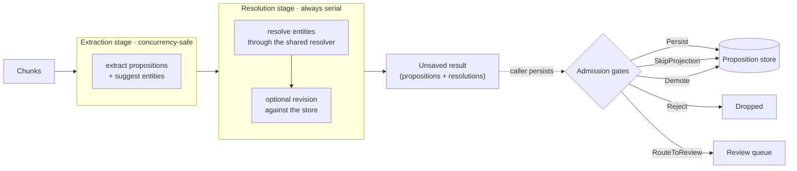
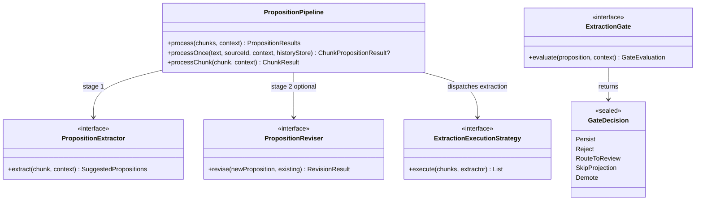
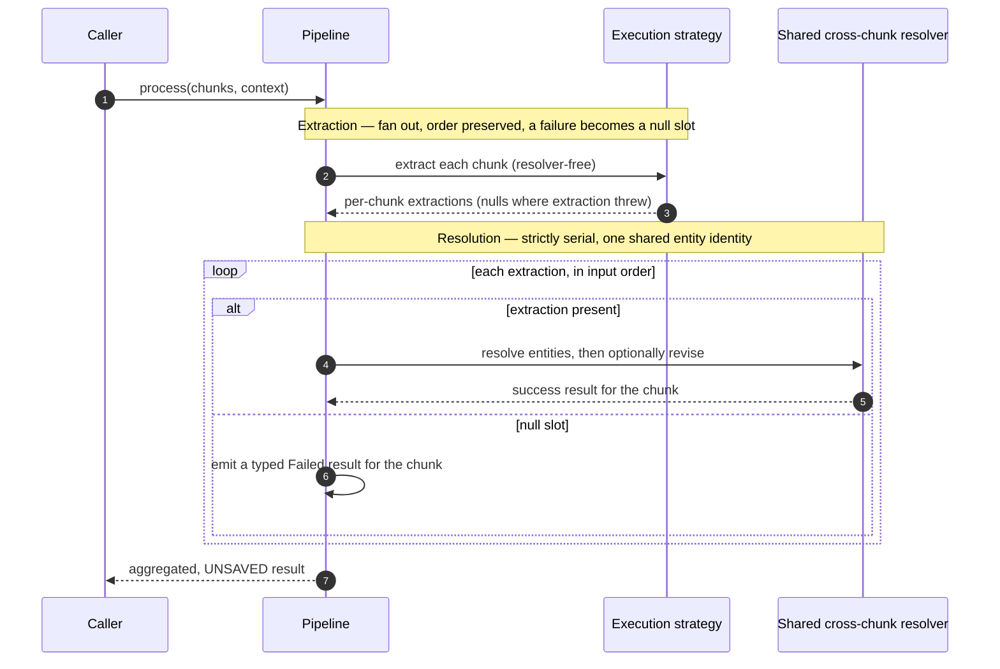
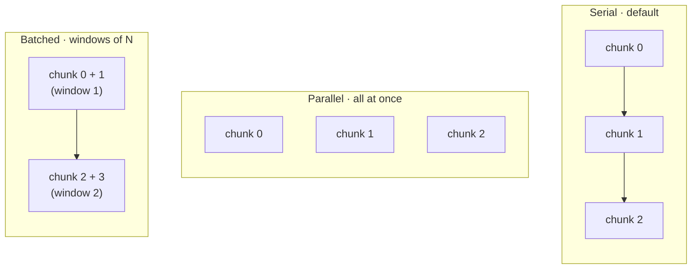
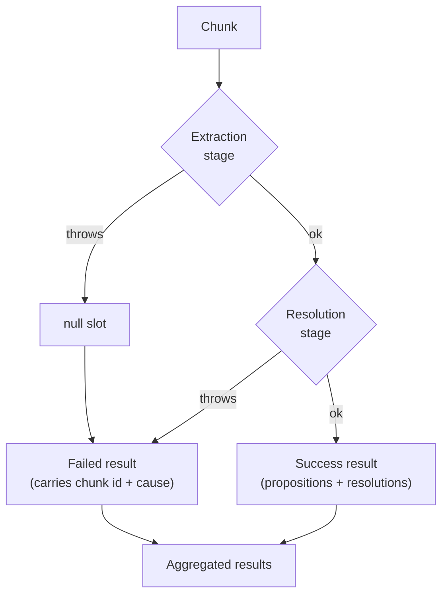
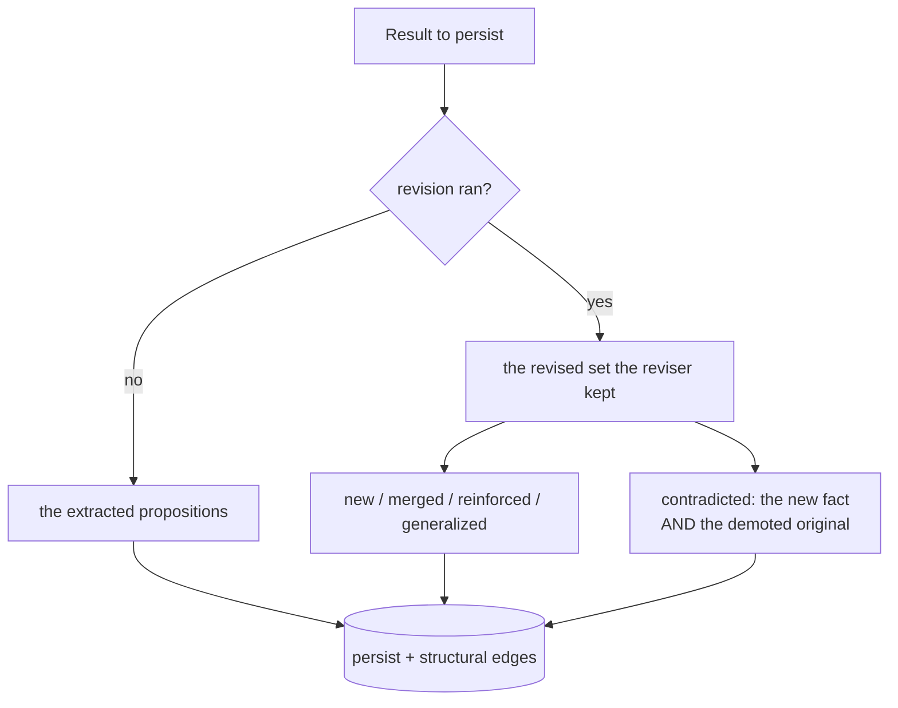

# Extraction pipeline: two stages, optional concurrency, and unsaved results

DICE turns raw text into grounded propositions through one pipeline. It chunks nothing and stores
nothing itself — it takes chunks in, extracts statements, resolves the entities those statements
mention, optionally reconciles them against what's already known, and hands back a result the
caller persists. This note is about three design decisions behind that flow: why extraction and
resolution are kept as separate stages, why only the extraction stage is allowed to run
concurrently, and why the pipeline deliberately writes nothing.

The pipeline produces the propositions that everything downstream then governs — the admission
gates decide what to keep, the lifecycle decides how each one ages, and the dream loop tidies them
later (see [knowledge-hygiene](knowledge-hygiene.md) and
[proposition-lifecycle](proposition-lifecycle.md)). This is where they come from.



The admission gates (see [knowledge-hygiene](knowledge-hygiene.md)) run between the pipeline result and the store — they are the caller's responsibility to apply.

## Pipeline extension points

Every variable part of the pipeline is a pluggable interface. This is how they fit together:



## Using the pipeline

Build a pipeline from an extractor, optionally chain in revision, then run it over chunks:

```kotlin
val pipeline = PropositionPipeline
    .withExtractor(LlmPropositionExtractor(ai))
    .withRevision(reviser, propositionRepository)  // Optional

val result = pipeline.process(chunks, context)
```

A gate is a plain function from proposition + context to a routing decision, applied by the caller
after the pipeline runs and before it saves anything:

```kotlin
val confidenceGate = ExtractionGate { proposition, _ ->
    val decision = if (proposition.effectiveConfidence() < 0.5) {
        GateDecision.Reject("confidence below threshold")
    } else {
        GateDecision.Persist
    }
    GateEvaluation("ConfidenceGate", proposition, decision)
}
```

## Why extraction and resolution are separate

Extraction is two jobs wearing one coat. One reads a chunk and produces *candidate* statements and
the entities they mention — pure work that depends only on the chunk in front of it. The other
takes those candidates and decides *which real entities* they refer to, which means consulting a
resolver that accumulates identity across the whole run.

Keeping them as distinct stages is what makes safe concurrency possible at all. The extraction
stage (`extractStage`) touches no resolver and shares no state between chunks, so two chunks can be
extracted at the same time without stepping on each other. The resolution stage (`resolveStage`)
runs every chunk through one shared cross-chunk resolver so that "Brahms" mentioned in one chunk
lands on the same entity as "Brahms" in another — and that shared, mutating identity map is exactly
the thing you cannot touch from several threads at once. So the line between the two stages is also
the line between "parallelizable" and "must stay serial."



## Mention grounding

A model sometimes attaches a mention to a proposition that does not name that entity, usually
because it saw the entity elsewhere in the chunk. Resolving that mention can link the proposition to
the wrong thing, or mint an entity nothing in the claim supports. So before any mention becomes a
resolver candidate, the pipeline screens the mentions of each proposition.

Screening has one extension point, `MentionFilter`. The pipeline calls
`validateMentions(proposition, context)` once per proposition and gets one `ValidationResult` per
mention, in order. It applies two checks itself, for every `PropositionExtractor`, and passes `null`
as the filter argument of `toSuggestedEntities`.

| Check | Set by | Default | A rejected mention |
|---|---|---|---|
| Grounding | `withMentionGrounding(check)` | `GroundedMentionFilter` | `withUngroundedMentions`: `KEEP` (default) or `DROP` |
| Filter | `withMentionFilter(filter)`, `withMentionFilter(filter, handling)` | none | `LEAVE_UNRESOLVED` (default), `KEEP` or `DROP` |

| `RejectedMentionHandling` | Resolver candidate | Stays on the proposition |
|---|---|---|
| `KEEP` | yes | yes |
| `LEAVE_UNRESOLVED` | no | yes |
| `DROP` | no | no |

Grounding runs first, and the filter sees each proposition as grounding left it. The proposition
itself is always kept. A proposition that loses every mention is revised and retrieved like any
other proposition without mentions. Screening runs in the extraction stage, so a filter can be
called from several threads at once.

The grounding check answers one question, whether the text of a proposition supports a mention. A
rule about anything else goes in the filter. `GroundedMentionFilter` accepts a mention when its span
is in that text. It also accepts a mention whose span equals the name or an alias of a known
entity of the analysis, when the text contains that entity's name or an alias. Names are compared
the way `KnownEntityResolver` compares them, so a title or a suffix makes no difference, and a
grounded mention resolves to that entity. `KnownEntityResolver` takes the first known entity with a
matching name, so a span that is the name of several known entities is grounded only when the text
names every one of them. A `suggestedId` alone grounds nothing: `KnownEntityResolver` does not
follow it, and a mention with the same span and type elsewhere could carry another. A blank span is
never grounded.

Grounding defaults to `KEEP` because the stock prompt asks for mentions the text only implies, such
as a `Cycling` mention on the proposition "Alice cycles". Such a mention is ungrounded, with or
without the entity's id.

Both sides are normalised before they are compared.

| Step | Effect |
|---|---|
| Ignored characters removed | Format characters (zero-width joiners and spaces, direction marks, soft hyphens), variation selectors, filler characters and the Arabic tatweel. |
| Dashes folded | Every dash-punctuation character and the minus sign match a hyphen. |
| Quotes folded | Curly, low and reversed quotes, primes, modifier apostrophes, the acute accent and the backtick match `'` or `"`. |
| Compatibility composition (NFKC) | Composed and decomposed accents match, and so do width forms. |
| Whitespace collapsed | Any run of whitespace matches one space. |
| Full case folding | Letter case is ignored, and "Strasse" matches the same word spelled with a sharp s. |

Accents are significant. In Latin, Cyrillic, Greek, Armenian and Georgian text, and between digits,
the span must sit at word edges: "US" is not in "focus" and "Ann" is not in "Annabel", while "Brien"
is in "O'Brien". An inflected or plural form is a different word, so "Apple" is not in "Apples",
and a name run together with a number is too, so "iPhone" is not in "iPhone15".
Every other script is matched by containment, because many of them write words without spaces or
attach particles to a name. A symbol that composition spells out as letters or digits, such as a
trade mark sign or a footnote digit, does not join the word beside it. The text of a proposition is
normalised once, however many mentions it has.

Under DROP, the mentions grounding drops can pass a `suggestedId` on to the resolver candidates
with the same span and type. Resolution gives every mention of one span and type the same id, so
this is decided once per span and type for the whole chunk, never per proposition. A span and type
gets an id only when every dropped mention of it that carries an id carries the same one, that id
belongs to a known entity of the analysis whose name or an alias is the span (compared the way
`GroundedMentionFilter` compares names), no other span and type would take the same id, and no
candidate of it holds an id of its own. So the id can only choose among the known entities the span
itself names, and never points a mention at something its own text does not name. The filter has
judged every mention as written and is not asked again. The propositions keep their mentions as the
model wrote them, and a rejection always reports the mention as the model wrote it.

A mention left unresolved keeps no id, even when another mention with the same span and type is
resolved. Resolution assigns ids by span and type, so the pipeline takes the id off afterwards by
position: `PropositionExtractor.resolvePropositions` returns one proposition per suggested
proposition, in order, with the mentions in order. When an extractor's output does not line up
with what it was given, by span and type or by count, the pipeline takes the id off every mention
in the propositions that do not line up whose span and type was left unresolved anywhere in the
chunk, and logs one warning with counts. A mention left unresolved or dropped never keeps an id; a
mention the filter only reports under `KEEP` is resolved like any other.

Every rejection is on the chunk result as a `RejectedMention`: the chunk id, the position and text
of the proposition, the mention, the reason, which check rejected it and what the pipeline did with
it. `PropositionResults.rejectedMentions` lists them for a whole run. Each chunk with a grounding
rejection also emits one `UngroundedMentionsFound` event, with the reason as `BLANK_SPAN` or
`SPAN_NOT_IN_PROPOSITION`. The pipeline logs one line of counts per chunk, at warning level when a
mention was dropped or left unresolved and at debug level otherwise. Spans and reasons are logged at
debug level only.

## Execution strategies

How the extraction stage is dispatched is a pluggable choice, separated from the pipeline behind a
small SPI so that turning on concurrency is a one-line swap rather than a rewrite. Three strategies
ship:

- **Serial** (the default) runs each chunk one at a time on the calling thread. It is the
  simplest, fully sequential behaviour, so the default pipeline has no concurrency to reason about.
- **Parallel** fans every chunk out at once onto an executor and joins them back in order.
- **Batched** processes fixed-size windows: each window runs concurrently, then fully completes
  before the next starts. This is the rate-limit lever — it caps how many extractions (and so how
  many model calls) are in flight at a time.

Every strategy honours the same two-part contract, and the contract is what lets the rest of the
pipeline stay simple. **Input order is preserved**: the result has one slot per input chunk, in
order. **A failure is a `null` slot, never an exception and never a dropped chunk** — when an
extraction throws, that slot comes back `null`, and the resolution stage turns it into a typed
`Failed` result. Nothing is silently reordered or lost, so the `result.size == chunks.size`
invariant always holds.



### Turning concurrency on is gated

Going faster than serial is opt-in for a reason: it is only safe if the `PropositionExtractor`
behind the pipeline — usually a language-model client — is itself safe to call from several threads
at once. That is a property of the extractor, not something the pipeline can guarantee, so the
default stays serial and a deployment is expected to verify thread-safety before switching. Until
then, `BatchedExtractionStrategy(batchSize = 1)` is the documented degrade-to-serial path: it goes
through the concurrent code path but never actually overlaps two calls, producing byte-identical
output to the serial strategy.

### Who owns the executor

A strategy either borrows an executor or makes its own, and the rule is symmetric with ownership. A
caller-supplied executor is never shut down by the strategy — its lifecycle belongs to whoever
created it. A strategy that creates its own pool (the no-executor constructors) owns that pool, and
both concurrent strategies are `AutoCloseable` so `close()` shuts down a self-created pool and
leaves a borrowed one alone. The practical guidance: inject and manage your own executor in a
long-lived application; use the no-arg constructor as a `use { }` resource for a one-off.

## Failure is isolated per chunk

The batch path treats every chunk as independent, so one bad chunk can't sink a whole document. A
chunk that throws during extraction becomes a `null` slot; a chunk that throws during resolution,
revision, or even event emission is caught in the resolution stage and turned into a `Failed`
result for that chunk alone. Either way the run finishes and the failures are visible —
`PropositionResults` exposes the ids of chunks that failed, and the REST layer surfaces them rather
than pretending everything succeeded.

Single-chunk processing is deliberately stricter. `processChunk` runs both stages serially on the
calling thread and lets an extraction exception propagate, because a caller handling one chunk
wants the error, not a quietly empty result. Only the batch `process` converts failures into
`Failed` slots, because that is where swallowing one chunk to save the other forty is the right
trade.



## The result, and who persists it

The pipeline returns **unsaved** results on purpose. `process`, `processChunk`, and `processOnce`
all write nothing to any repository; the returned value is discarded if the caller ignores it. The
reason is transaction ownership — DICE is a substrate a host application embeds, and that
application owns its database transaction. Baking writes into the pipeline would force its
persistence model onto every consumer; handing back what *should* be saved leaves the boundary, and
the rollback story, with the caller.

What to save is itself a small decision, captured in `propositionsToPersist()`. With no revision,
that's just the freshly extracted propositions. With revision, it's the set the reviser says to
keep — which crucially includes *modified existing* propositions, not only new ones. A contradiction,
for example, returns both the new fact and the existing one whose confidence was cut and status set
to `CONTRADICTED`; persisting only the new fact would silently leave the old one believed (see
[proposition-lifecycle](proposition-lifecycle.md)).



The convenience `persist()` helper writes the right propositions, saves only the entities those
propositions actually reference, and wires up the structural relationships between chunks,
propositions, and entities in one step — but it's still the caller who chooses to call it, inside
its own transaction.

## Revision, events, and provenance

When a reviser and a repository are configured, the resolution stage also reconciles each new
proposition against what's stored and classifies the relationship — new, merged, reinforced,
contradicted, or generalized. Those classifications drive the lifecycle transitions described in
[proposition-lifecycle](proposition-lifecycle.md), and each one emits a *pre-persistence* event so a
consumer can watch reconciliation happen; the durable record is still the `PropositionPersisted`
the store emits on save (see [events](events.md)). `processOnce` adds a hash check so re-ingesting
the same text is a no-op, and lets a caller attach extra grounding ids — the source records a fact
came from — that later become provenance edges.

Every piece here — extractor, reviser, mention filter, event listener, execution strategy — is
pluggable through the pipeline's fluent builders, and what ships defaults to the conservative choice
at each one (serial, revision off, no persistence).
