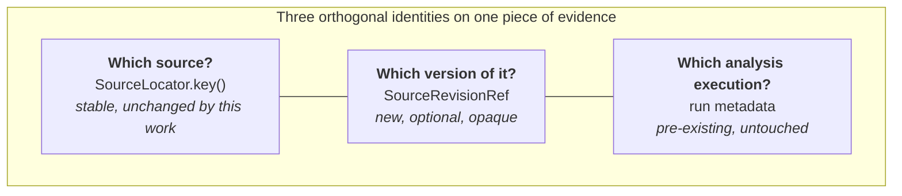
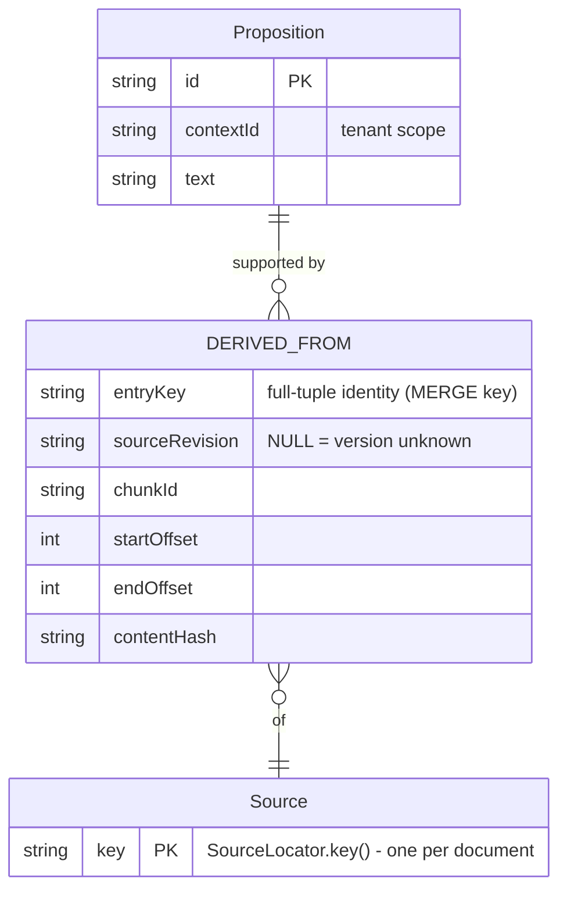
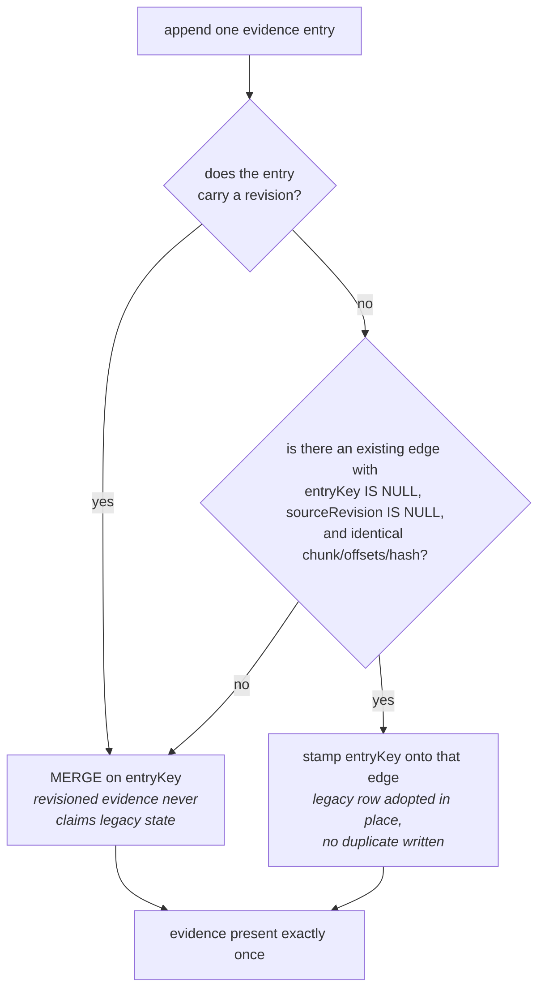
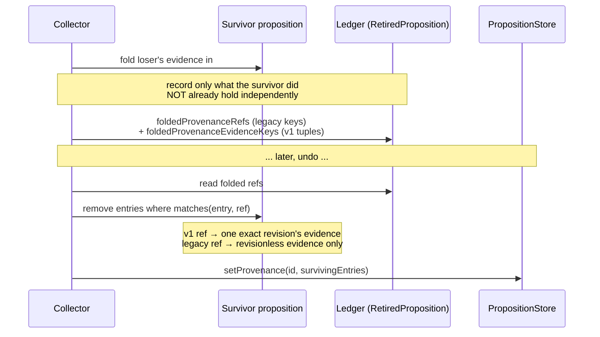

# Source revisions: knowing *which version* of a source a fact came from

Sources change. A Notion page gets edited, a Google Doc gains a paragraph, a Confluence article
is rewritten. DICE already recorded *which source* a proposition came from — that's what
`ProvenanceEntry` and its `SourceLocator` do. What it could not record was *which version of
that source*. Re-ingesting an edited page produced evidence indistinguishable from the evidence
the first ingest produced, so questions an auditor actually asks — "which revision of this
document did we believe this from?", "what did we learn from the version before the edit?",
"if this page was rewritten, which of our facts are now standing on the old text?" — had no
answer in the store.

This note describes how an optional, opaque **source revision** is carried end to end, and —
just as importantly — what it deliberately does *not* change.

## Three identities, not one

The single most important idea here is that a piece of evidence sits at the intersection of
three orthogonal identities, and this feature adds exactly one of them without disturbing the
other two.



- **Which source** is `SourceLocator.key()`. It is the canonical identity of a document, and it
  is *deliberately unchanged*. Two revisions of the same page share one `:Source` node and one
  key. This is what keeps every existing query, every stored graph edge, and every legacy trace
  value meaning what it always meant.
- **Which version** is the new `SourceRevisionRef(sourceKey, sourceRevision)`. The revision
  string is **opaque to DICE** — an ETag, a Notion `last_edited_time`, a git SHA, a monotonic
  version counter, whatever the connector has. DICE never parses it, never orders it, never
  infers "newer" from it. It only ever tests two revisions for equality.
- **Which analysis execution** is run metadata, which already existed and is untouched. A single
  run can read many sources; a single source revision can be read by many runs. Conflating the
  two is the mistake this design avoids: *lineage of the analysis* and *version of the input*
  are different questions.

`SourceRevisionRef` carries the source key alongside the revision precisely so a revision can
never float free of the document it belongs to:

```kotlin
data class SourceRevisionRef(
    val sourceKey: String,
    val sourceRevision: String,
) {
    init {
        require(sourceKey.isNotBlank()) { "sourceKey must not be blank" }
        require(sourceRevision.isNotBlank()) { "sourceRevision must not be blank" }
    }
}
```

Both fields are required and non-blank. There is no such thing as a revision of nothing. At the
request boundary, `SourceAnalysisContext` enforces the pairing — if you set a revision you must
also supply the locator, and the revision's `sourceKey` must equal `sourceLocator.key()`.

## Absence is a value

`ProvenanceEntry.sourceRevision` is nullable, and null is not a bug — it is the honest statement
**"we do not know which version this came from."** That covers every row written before this
feature existed, plus every connector that has no revision concept to report.

This matters more than it looks. A store that coerced null into `""` or `"unknown"` would make
"we never knew" indistinguishable from "the provider told us the revision is empty". Keeping
them distinct is what lets the third query below — revisionless-only — mean something precise:
*find the facts whose source version we cannot account for*. For a backfill or an audit, that
set is exactly the work list.

The entry itself stays a single flat shape, with revision as one more optional detail alongside
the chunk, offsets, and content hash:

```kotlin
data class ProvenanceEntry @JvmOverloads constructor(
    val locator: SourceLocator,
    val chunkId: String? = null,
    val startOffset: Int? = null,
    val endOffset: Int? = null,
    val contentHash: String? = null,
    val sourceRevision: String? = null,   // new, trailing, defaulted
)
```

Being trailing and defaulted is what preserves the existing Java constructor arities, and
`@JvmOverloads` keeps the old call shapes compiling and linking.

### Revision vs content hash

These two look similar and answer different questions, so it is worth being explicit. The
**content hash** is DICE's own observation of the bytes it read; comparing it later reveals that
a source has changed *since we looked*. The **revision** is the provider's own name for that
version. A content hash can tell you something changed; only the revision lets you say *which
published version* you were reading, ask the provider for it again, or line your evidence up
against the provider's history. They coexist and neither replaces the other.

## The evidence tuple is the identity

Once a revision exists, the locator alone is no longer enough to identify a piece of evidence. A
proposition can legitimately be supported by "chunk 3 of revision A" *and* "chunk 3 of revision
B" — same document, same offsets, genuinely two distinct observations. So the identity of an
evidence row is the **full tuple**:

```
locator.key() │ sourceRevision │ chunkId │ startOffset │ endOffset │ contentHash
```

Encoding that tuple has one subtlety worth naming: the fields are free-form strings, so any
plain delimiter can appear inside a value, and null must stay distinct from every string
including the empty one. Both encoders solve this with **length framing** — each field is
written as `<length>:<value>`, and a length of `-1` means null. Nothing needs escaping, and
`null`, `""`, and `"x:y"` can never collide.

`ProvenanceEvidenceKey` is the domain-side codec, and it version-stamps its output with a
`dice-provenance:v1:` prefix. That prefix carries real weight: it is how a *new* key is told
apart from a *legacy* value at read time, which is what makes the collector undo path below
work without a migration.

> **Note for maintainers.** There are currently two encoders of this tuple — `ProvenanceEvidenceKey`
> in the domain and `provenanceStorageEntryKey` in `dice-storage` — with the same field order and
> the same framing but different prefixes, deliberately keeping graph identity decoupled from the
> public evidence-key format. They must be changed together. A test that pins both against the same
> fixtures is cheap insurance and is worth adding.

## What the graph looks like

Revision lives as a scalar **on the relationship**, not on the node. The `:Source` node stays
one-per-document, and the `DERIVED_FROM` edge carries the version.



That placement is the whole trick. Had revision gone on the `:Source` node, every revision would
have minted a new node, every existing edge would have needed rewriting, and `SourceLocator.key()`
could not have stayed stable. On the edge, two revisions of one page are two edges to one shared
node — and "all propositions from this document, any version" stays a single hop.

`entryKey` is the MERGE key. Writing evidence is `MERGE (p)-[r:DERIVED_FROM {entryKey: $entryKey}]->(s)`,
which makes appends **idempotent by construction**: replaying a run, or retrying after a failure,
converges instead of accumulating duplicate edges.

### Guarding the shared node

Because one `:Source` node is shared across revisions and across propositions, a key collision
would be silent corruption — two genuinely different documents fused into one node. So the write
path validates it: the source is merged and its stored identity fields (`kind`, `uri`, `path`,
`contentHash`, `connectorId`, `externalId`) are compared against the incoming locator, and a
mismatch fails loudly rather than writing.

## Reading legacy edges without a migration

Every `DERIVED_FROM` edge written before this feature has no `entryKey` and no `sourceRevision`.
A naive MERGE on `entryKey` would ignore those edges entirely and write a *second* edge alongside
each one — silently doubling the evidence for every fact in an existing store.

Instead, evidence is **adopted lazily**, on write, under a deliberately narrow rule:



Two properties are doing the work here. **Only a revisionless entry may adopt a legacy edge** —
revisioned evidence is new information and must never absorb a row whose version was unknown.
And **adoption requires an exact match on every other field**, so an entry that differs in chunk
or offsets writes its own edge rather than overwriting an unrelated one.

The result is that no migration runs, no downtime is needed, and an untouched store stays
untouched. Legacy rows are upgraded only when something rewrites them anyway. The cost, stated
plainly: a store can hold both adopted and un-adopted legacy edges indefinitely, so anything
reading raw edges must tolerate a null `entryKey`.

## Querying by source and revision

Three tenant-scoped queries sit on `PropositionRepository`, all taking a `ContextId` first —
tenant scoping is a parameter of the query, not a filter applied afterwards:

| Query | Matches | Answers |
| --- | --- | --- |
| `findBySourceKey(contextId, sourceKey)` | any evidence for that document, revisioned or not | "everything we believe from this page" |
| `findBySourceRevision(contextId, ref)` | evidence whose key **and** revision match exactly | "what we learned from *this version*" |
| `findRevisionlessBySourceLocator(contextId, locator)` | evidence for that document with `sourceRevision IS NULL` | "what we believe from this page but can't version" |

The three partition cleanly: `findBySourceKey` is the union, and the other two are disjoint
subsets of it. Each has a Java-friendly `String` overload alongside the `ContextId` one.

The interface supplies in-memory default implementations that filter loaded provenance, which
keeps simple backends correct for free. Backends whose normal context reads omit or abbreviate
provenance — the Drivine one does exactly that, for good performance reasons — **must override
the typed methods** and push the predicate into the database. That obligation is stated on the
interface, and it is the kind of contract that is easy to get silently wrong in a future backend:
inheriting the default would quietly return answers filtered from provenance that was never
loaded.

## Collector fold and undo

When the multi-signal collector collapses duplicates, the loser's evidence is folded into the
survivor and the fold is recorded so it can be reversed. Revisions make that ledger harder: undo
must strip back *exactly* what was folded, and "evidence from document X" is no longer precise
enough to name a single row.

So the retirement record carries evidence keys as well as the legacy locator refs, and the
removal side matches with `ProvenanceEvidenceKey.matches(entry, ref)` rather than string
equality. That predicate is where backward compatibility is actually paid for:

- A **new-format ref** (`dice-provenance:v1:…`) matches one full tuple — one specific revision's
  evidence, and nothing else.
- A **legacy ref** (a bare locator key, no magic prefix) matches only entries whose
  `sourceRevision` is null.

That second rule is the important one. An old ledger row saying "I folded evidence from document
X" was written in a world with no revisions, so honouring it as "remove revisionless evidence
from X" is the only reading that cannot destroy evidence the row never meant to cover. A ledger
written before this feature can therefore still be replayed against a store that has since
gained revisioned evidence, and it will leave that newer evidence alone.



Note the "did not already hold independently" step: evidence the survivor had on its own is
excluded from the ledger, so undo cannot strip evidence the fold never contributed.

Undo writes through `PropositionStore.setProvenance` — an **authoritative** replacement, unlike
the append-only `save` path. Putting it on the base store contract (rather than probing at
runtime for a richer repository type) means an evidence-sensitive operation like undo depends on
the capability explicitly, and a backend that cannot honour it fails visibly instead of silently
appending where it was asked to replace.

## The compatibility boundary, stated honestly

What is preserved:

- **Kotlin and Java source compatibility**, with the accepted old Java constructor arities and
  existing public method descriptors held by executable interop checks.
- **Legacy JSON reads.** Revision is additive; a document without the field deserializes to a
  null revision.
- **Legacy trace and locator values**, which remain readable and keep their original meaning.
- **Stored revisionless provenance**, preserved as-is and adopted only when rewritten.
- **`SourceLocator.key()`**, unchanged — the load-bearing guarantee underneath all of the above.

What is explicitly *not* claimed: **full Kotlin synthetic constructor and `copy` binary ABI
compatibility**. Adding a parameter to a Kotlin data class changes the synthetic `copy$default`
and constructor descriptors, and no amount of `@JvmOverloads` fixes that. A pre-built Kotlin
client that calls `ProvenanceEntry.copy(...)` and is *not* recompiled can still break. That
boundary is deliberate and out of scope; the executable fixture in the test suite pins what *is*
claimed rather than asserting it in prose.

## What an auditor can now ask

Pulling the pieces together, the questions this makes answerable:

- *Which version of this document did we believe fact F from?* — read `sourceRevision` on F's
  provenance entry.
- *What did we learn from revision R specifically?* — `findBySourceRevision`.
- *This page was rewritten; which of our facts are standing on some version of it?* —
  `findBySourceKey`, then compare each entry's revision against the current one.
- *Which facts can we not account for by version at all?* — `findRevisionlessBySourceLocator`.
  This is the backfill work list.
- *Was this evidence folded in from a duplicate, and can that be reversed?* — the collector
  ledger, now precise to the revision.

And the question that is still **not** answerable, which is worth stating so nobody assumes
otherwise: **DICE cannot tell you which revision is newer.** Revisions are opaque and unordered
by design. "Is this fact stale relative to the current version of the page?" requires asking the
connector what the current revision is and comparing for equality — DICE will tell you *what you
read*, not *whether it is still current*.

### One gap to know about on the incremental path

`findBySourceRevision` answers "what did we learn from revision R" only for revisions that
actually reached extraction. The incremental analyzer gates work on two keys that predate this
feature and do not include the revision: a bookmark keyed by `(contextId, sourceId)`, and a
content-hash key of `(contextId, contentHash)`.

The consequence is narrow but real. Re-analyze the same source at a new revision whose *content
is unchanged*, and the content-hash gate skips the window before extraction runs — so no evidence
is recorded for the new revision, and `findBySourceRevision` for it comes back empty even though
that revision genuinely does attest those facts. An auditor reconstructing which published
versions support a fact will see a hole wherever a revision changed metadata but not text.

Skipping re-extraction is the right call — the content is identical, there is nothing new to
learn. What is missing is attaching the new revision's provenance to the propositions already
derived from that content. Until that is closed, read a revisionless or absent result on this
path as "not observed" rather than "not supported".

## Sharp edges worth knowing before you trust the record

Two more places where the evidence record is less complete than it looks. Both are narrow, both
are current behaviour rather than intent, and an auditor should know about them.

**A trace that round-trips through JSON loses precise undo.** `RetiredProposition` carries the
evidence keys under `@get:JsonIgnore`, deliberately — they are opaque storage identities and the
trace is meant to stay human-readable. The two stores that ship are fine (the Drivine one
persists the field as a node property; the in-memory one holds live objects). But
`CollectorTraceStore` is an open SPI, so any implementation, export, or backup that serializes a
`CollectorDecision` through Jackson silently drops the keys. Undo then falls back to bare locator
refs — which, by the rule above, match only *revisionless* evidence. A fold of revisioned
evidence therefore becomes un-undoable: the retired proposition comes back, but its folded
entries stay on the survivor, with no error. Any trace store implementation must persist
`foldedProvenanceEvidenceKeys` out of band of Jackson.

**Dedup unions provenance but not grounding.** When an incoming proposition is deduplicated onto
an existing one with the same text, the winner gains the newcomer's provenance entries — but not
its `grounding` chunk ids or `sourceIds`. The result is a proposition whose provenance references
a chunk that its own grounding list does not contain. Before revisions this path dropped the
loser's evidence wholesale, which was lossy but self-consistent; unioning one of the three lists
is what creates the mismatch. It matters here because the collector ledger computes
`foldedGrounding` and `foldedProvenanceEvidenceKeys` from those two now-divergent lists.

## Related notes

- [durable-storage.md](durable-storage.md) — the `PropositionStore` SPI family and the Neo4j
  backend this extends.
- [graph-projection.md](graph-projection.md) — the wider lineage-to-evidence graph these
  `DERIVED_FROM` edges live in.
- [grounding-and-conflicts.md](grounding-and-conflicts.md) — how propositions stay anchored to
  source material generally.
- [multi-signal-collector.md](multi-signal-collector.md) and
  [collector-trace-store.md](collector-trace-store.md) — the collapse pipeline whose fold/undo
  ledger this makes revision-aware.
