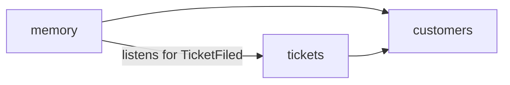

# Java

A support desk that remembers what its tickets say. Filing a ticket publishes an event. A
listener extracts facts from the ticket with DICE and stores them under the ticket's account.
`CustomerMemory` reads them back one account at a time.

## Run

```bash
./mvnw -B -f examples/pom.xml -pl examples-java -am verify
```

The example runs as tests. `StarterApplication` is the Spring Boot configuration they start. The
tests add `ScriptedModel`, which registers a model that replays recorded replies and makes it the
default. `TicketMemoryTests` files four tickets for two accounts and asserts what is remembered.

## Modules

The application is split by feature. Each package under `example.dice.starter` is a module.
The compiler keeps package-private types inside their module. `ModularityTests` uses Spring
Modulith to verify that the modules have no dependency cycle.



| Package | Public types | Package-private |
|---|---|---|
| `customers` | `AccountId`, and the schema types `Customer`, `Contact`, `Plan` | |
| `tickets` | `Ticket`, `Ticket.TicketId`, `Ticket.TicketFiled`, `Tickets` | |
| `memory` | `CustomerMemory` | `AccountStores`, `MemoryConfiguration`, `TicketExtraction`, `UngroundedMentionLog` |

A `Ticket` carries a revision number: 1 when it is filed, and one more for each edit.

`tickets` does not depend on `memory`. It publishes `TicketFiled`, and `memory` listens.

## DICE usage

| Step | Where | What to read |
|---|---|---|
| Define a schema | `MemoryConfiguration.supportSchema` | Three domain types passed to `DataDictionary.fromClasses`. The model tags mentions with these names. |
| Build the pipeline | `MemoryConfiguration.propositionPipeline` | `PropositionPipeline` with an LLM extractor, an event listener, and ungrounded mentions dropped. |
| Handle pipeline events | `MemoryConfiguration.diceEvents`, `UngroundedMentionLog` | DICE events are republished as Spring events and handled with `@EventListener`. |
| Resolve entities | `AccountStores`, `TicketExtraction.on` | `EscalatingEntityResolver` looks mentions up by name in the store it is given. Each account has its own store and one resolver built on it. |
| Extract each revision once | `TicketExtraction.on` | The fact store is the record of what was stored. `findBySourceRevision` finds a revision delivered again. Otherwise `findBySourceKey` returns every fact read from the ticket, and a revision no newer than the highest one among them is skipped, which covers a late copy of an earlier revision. |
| Store as one unit | `TicketExtraction.on` | `processText` returns unsaved results. `PersistUnitWriter.inMemory` stores them as one `PersistUnit` and puts the facts and entities back when a step fails. A relationship written before the failure stays. |
| Replace an edited ticket's facts | `TicketExtraction.on`, `TicketExtraction.takeTicketOff` | The ticket is the `SourceLocator` and its revision number is the `SourceRevisionRef`. A fact only this ticket supports is stored as `SUPERSEDED` in the same unit as the new facts. A fact another ticket also supports then loses this ticket's evidence and grounding through `subtractFoldedEvidence` and stays current. |
| Check the fact store | `TicketExtraction` constructor | The checks are made on the store the writer saves to. It has to report `supportsSourceRevisionQueries` and `supportsProvenanceSubtraction`, or extraction refuses to start. |
| Query | `CustomerMemory` | `PropositionQuery` scoped to one context, filtered by status, with confidence judged at a given time. |

[`TicketExtraction`](src/main/java/example/dice/starter/memory/TicketExtraction.java) has the
whole listener.

`PersistUnit`, `PersistUnitWriter`, `PersistOutcome`, `SourceRevisionRef`, the source revision queries and provenance subtraction are marked experimental in DICE.

The lock is held through the model call. DICE resolves a ticket's mentions inside `processText`,
and the entities it creates are stored by the write that follows, so two tickets of one account
handled at once could each create the same new customer. Tickets of different accounts run at
the same time.

`AccountStores` keeps everything in memory, and every account it has seen stays there. The lock
works within one running application. An application with many accounts or several instances
keeps entities in a persistent store looked up by account, and delivers each account's tickets
to one instance at a time.

The facts only the earlier revisions support are stored as `SUPERSEDED` in the same unit as the
new facts, so a failed write leaves the earlier revision current. Each is read again after the
model call, so a change made while the model was answering is kept. A fact another ticket also
supports loses this ticket's evidence and grounding in one step, after the unit is stored, and
is superseded if no evidence is left. The entities the retired facts
named stay in the account's store, since another ticket may name them too. A revision whose
text gives no facts leaves nothing in the fact store, so a second delivery of it is extracted
again. If every fact of the revision before it was kept by another ticket, nothing names that
one either, and a late copy of it is extracted again too. An application that has to ignore
those keeps each ticket's latest revision in its own records.

Revisions are opaque strings to DICE. This example writes whole numbers and orders by them. A
revision under the ticket that is not a number was written by something else and counts as 0.

```java
propositions.query(
        PropositionQuery.againstContext(account.value())
                .withStatus(PropositionStatus.ACTIVE)
                .withEffectiveConfidenceAsOf(asOf)
                .withMinEffectiveConfidence(minConfidence)
                .orderedByEffectiveConfidence());
```

## Behaviour the tests assert

| Test | Behaviour |
|---|---|
| `keepsEachAccountsFactsToItself` | The account is the DICE context. A query for one account returns no fact from another. |
| `everyFactPointsBackAtItsTicket` | The ticket id is the source id, and each fact's grounding carries it. |
| `resolvesAMentionInALaterTicketToTheEntityFromAnEarlierOne` | "Acme" in the second ticket resolves to the entity the first ticket created. |
| `dropsAMentionItsSentenceNeverMakesAndReportsIt` | One recorded reply attaches "Ada Okafor" to a sentence that does not contain the name. The pipeline drops the mention, keeps the fact, and publishes `UngroundedMentionsFound`. |
| `givesEachAccountItsOwnEntityForASharedName` | Both accounts have a contact called Ada Okafor. Each account's mention resolves to an entity in its own store. |
| `filingTheSameTicketAgainStoresNothingNew` | A ticket filed twice is extracted once. The second filing makes no model call. |
| `keepsTheDecayRateTheModelGaveEachFact` | Each fact keeps the decay rate from the model's reply: 0.005 for the plan and 0.05 for the export problem. |
| `CustomerMemoryTests.factsWithAHighDecayRateStopBeingTrustedFirst` | After 30 days a fact with decay 0.005 keeps 74% of its confidence and a fact with decay 0.05 keeps 5%. |
| `RefiledTicketTests.anEditedTicketReplacesWhatItsEarlierVersionSaid` | Revision 2 is extracted again. The facts from revision 1 stay stored as `SUPERSEDED`, and `currentFacts` returns only what revision 2 says. |
| `RefiledTicketTests.aTicketEditedBackSaysWhatItFirstSaid` | Revision 3 has revision 1's text. It is extracted and supersedes the facts of revision 2. |
| `RefiledTicketTests.aLateCopyOfAnEarlierRevisionChangesNothing` | Revision 1 delivered again after revision 2 makes no model call, and `currentFacts` still returns what revision 2 says. |
| `RefiledTicketTests.aFactAnotherTicketAlsoSaysStaysWhenTheTicketIsEdited` | A fact that a second ticket also supports loses only the edited ticket's evidence and stays current. What only the edited ticket said is superseded. |
| `RefiledTicketTests.aRevisionTheApplicationDidNotNumberIsIgnored` | A stored revision that is not a number does not stop the edit. |
| `RefiledTicketTests.aTicketFiledFromSeveralThreadsAtOnceIsStoredOnce` | Eight threads file one ticket. One model call is made and each fact is stored once. |
| `FailedSaveTests.aTicketWhoseSaveFailedIsStoredOnceWhenItIsFiledAgain` | The entity store fails after the facts are saved. The writer takes the facts and entities back out, and filing the ticket again stores each fact once. |
| `FailedSaveTests.anEditWhoseSaveFailedLeavesTheEarlierRevisionCurrent` | The save of revision 2 fails. Revision 1's facts are current again, and filing revision 2 again stores it. |
| `TicketExtractionTests.refusesAFactStoreThatCannotFindFactsByTicket` | Extraction does not start on a fact store whose `supportsSourceRevisionQueries` is false. |
| `TicketExtractionTests.refusesAFactStoreThatCannotTakeEvidenceOffAFact` | Extraction does not start on a fact store that cannot subtract provenance. |
| `TicketExtractionTests.refusesAFactStoreThatReportsItCannotTakeEvidenceOffAFact` | Nor on one whose `supportsProvenanceSubtraction` is false. |
| `TicketsTests.aTicketStartsAtRevisionOne` | A ticket with revision 0 is rejected. |
