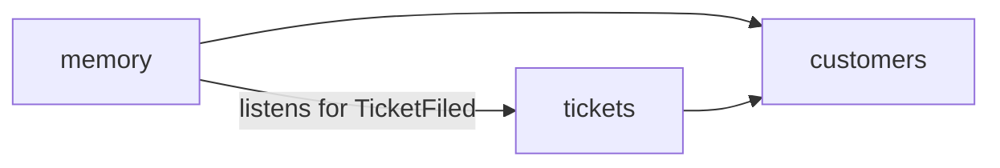

# Java

A support desk that remembers what its tickets say. Filing a ticket publishes an event. A
listener extracts facts from the ticket with DICE and stores them under the ticket's account.
`CustomerMemory` reads them back one account at a time.

## Run

```bash
./mvnw -B -f examples/pom.xml -pl examples-java -am verify
```

The example runs as tests. `StarterApplication` is the Spring Boot configuration they start, with a
scripted model as the default model. `TicketMemoryTests` files four tickets for two accounts and
asserts what is remembered.

## Modules

The application is split by feature. Each package under `example.dice.starter` is a module.
The compiler keeps package-private types inside their module. `ModularityTests` uses Spring
Modulith to verify that the modules have no dependency cycle.



| Package | Public types | Package-private |
|---|---|---|
| `customers` | `AccountId`, and the schema types `Customer`, `Contact`, `Plan` | |
| `tickets` | `Ticket`, `Ticket.TicketId`, `Ticket.TicketFiled`, `Tickets` | |
| `memory` | `CustomerMemory` | `AccountStores`, `MemoryConfiguration`, `TicketExtraction`, `UngroundedMentionLog` |

`tickets` does not depend on `memory`. It publishes `TicketFiled`, and `memory` listens.

## DICE usage

| Step | Where | What to read |
|---|---|---|
| Define a schema | `MemoryConfiguration.supportSchema` | Three domain types passed to `DataDictionary.fromClasses`. The model tags mentions with these names. |
| Build the pipeline | `MemoryConfiguration.propositionPipeline` | `PropositionPipeline` with an LLM extractor, an event listener, and ungrounded mentions dropped. |
| Handle pipeline events | `MemoryConfiguration.diceEvents`, `UngroundedMentionLog` | DICE events are republished as Spring events and handled with `@EventListener`. |
| Resolve entities | `AccountStores`, `TicketExtraction.on` | `EscalatingEntityResolver` looks mentions up by name in the store it is given. Each account has its own store and one resolver built on it. |
| Extract each version once | `TicketExtraction.on`, `AccountStores` | One ticket of an account is handled at a time. A ticket whose stored version is the hash of its text is skipped. The version is recorded after its facts are stored. |
| Store as one unit | `TicketExtraction.on` | `processText` returns unsaved results. `PersistUnitWriter.inMemory` stores them as one `PersistUnit` and puts the facts and entities back when a step fails. A relationship written before the failure stays. |
| Replace an edited ticket's facts | `TicketExtraction.on` | The ticket is the `SourceLocator` and the hash of its text is the `SourceRevisionRef`. `findBySourceKey` returns the facts read from earlier versions. They are stored as `SUPERSEDED` in the same unit as the new facts. |
| Query | `CustomerMemory` | `PropositionQuery` scoped to one context, filtered by status, with confidence judged at a given time. |

```java
var stores = accountStores.of(account);

var source = new ConnectorRef("tickets", ticketId);
var version = new SourceRevisionRef(source.key(), Sha256ContentHasher.INSTANCE.hash(ticket.text()));

stores.lock().lock();
try {
    if (version.getSourceRevision().equals(stores.storedVersions().get(ticket.id()))) {
        return;
    }

    var context = SourceAnalysisContext
            .withContextId(account.value())
            .withEntityResolver(stores.resolver())
            .withSchema(schema)
            .withMintNewEntities(true)
            .withSourceLocator(source)
            .withSourceRevision(version);

    var extracted = pipeline.processText(ticket.text(), ticketId, context);

    var replaced = sourceQueries.findBySourceKey(account.value(), source.key()).stream()
            .filter(fact -> fact.getStatus() == PropositionStatus.ACTIVE)
            .map(fact -> fact.withStatus(PropositionStatus.SUPERSEDED))
            .toList();
    var facts = Stream.concat(replaced.stream(), extracted.propositionsToPersist().stream()).toList();

    stores.writer()
            .write(PersistUnit.of(facts, extracted.newEntities(), extracted.updatedEntities()))
            .persistedOrThrow();

    stores.storedVersions().put(ticket.id(), version.getSourceRevision());
} finally {
    stores.lock().unlock();
}
```

`PersistUnit`, `PersistUnitWriter`, `PersistOutcome`, `SourceRevisionRef` and the source revision queries are marked experimental in DICE.

```java
propositions.query(
        PropositionQuery.againstContext(account.value())
                .withStatus(PropositionStatus.ACTIVE)
                .withEffectiveConfidenceAsOf(asOf)
                .withMinEffectiveConfidence(minConfidence)
                .orderedByEffectiveConfidence());
```

## Behaviour the tests assert

| Test | Behaviour |
|---|---|
| `keepsEachAccountsFactsToItself` | The account is the DICE context. A query for one account returns no fact from another. |
| `everyFactPointsBackAtItsTicket` | The ticket id is the source id, and each fact's grounding carries it. |
| `resolvesAMentionInALaterTicketToTheEntityFromAnEarlierOne` | "Acme" in the second ticket resolves to the entity the first ticket created. |
| `dropsAMentionItsSentenceNeverMakesAndReportsIt` | One recorded reply attaches "Ada Okafor" to a sentence that does not contain the name. The pipeline drops the mention, keeps the fact, and publishes `UngroundedMentionsFound`. |
| `givesEachAccountItsOwnEntityForASharedName` | Both accounts have a contact called Ada Okafor. Each account's mention resolves to an entity in its own store. |
| `filingTheSameTicketAgainStoresNothingNew` | A ticket filed twice is extracted once. The second filing makes no model call. |
| `CustomerMemoryTests.factsWithAHighDecayRateStopBeingTrustedFirst` | After 30 days a fact with decay 0.005 keeps 74% of its confidence and a fact with decay 0.05 keeps 5%. |
| `RefiledTicketTests.anEditedTicketReplacesWhatItsEarlierVersionSaid` | An edited ticket is extracted again. The facts from its earlier version stay stored as `SUPERSEDED`, and `currentFacts` returns only what the edited text says. |
| `RefiledTicketTests.aTicketEditedBackSaysWhatItFirstSaid` | Changing the text back extracts the ticket again and supersedes the facts of the edit. |
| `RefiledTicketTests.aTicketFiledFromSeveralThreadsAtOnceIsStoredOnce` | Eight threads file one ticket. One model call is made and each fact is stored once. |
| `FailedSaveTests.aTicketWhoseSaveFailedIsStoredOnceWhenItIsFiledAgain` | The entity store fails after the facts are saved. The writer takes the facts and entities back out, the ticket stays unrecorded, and filing it again stores each fact once. |
