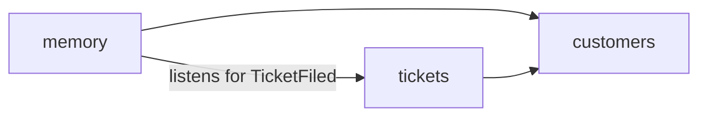

# Java

A support desk that remembers what its tickets say. Filing a ticket publishes an event. A
listener extracts facts from the ticket with DICE and stores them under the ticket's account.
`CustomerMemory` reads them back one account at a time.

## Run

```bash
./mvnw -B -f examples/pom.xml -pl examples-java -am verify
```

`TicketMemoryTests` files three tickets for two accounts and asserts what is remembered.

## Modules

The application is split by feature. Each package under `example.dice.starter` is a module.
The compiler keeps package-private types inside their module. `ModularityTests` uses Spring
Modulith to verify that the modules have no dependency cycle.



| Package | Public types | Package-private |
|---|---|---|
| `customers` | `AccountId`, and the schema types `Customer`, `Contact`, `Plan` | |
| `tickets` | `Ticket`, `Ticket.TicketId`, `Ticket.TicketFiled`, `Tickets` | |
| `memory` | `CustomerMemory` | `MemoryConfiguration`, `TicketExtraction`, `UngroundedMentionLog` |

`tickets` does not depend on `memory`. It publishes `TicketFiled`, and `memory` listens.

## DICE usage

| Step | Where | What to read |
|---|---|---|
| Define a schema | `MemoryConfiguration.supportSchema` | Three domain types passed to `DataDictionary.fromClasses`. The model tags mentions with these names. |
| Build the pipeline | `MemoryConfiguration.propositionPipeline` | `PropositionPipeline` with an LLM extractor, an event listener, and ungrounded mentions dropped. |
| Handle pipeline events | `MemoryConfiguration.diceEvents`, `UngroundedMentionLog` | DICE events are republished as Spring events and handled with `@EventListener`. |
| Resolve entities | `MemoryConfiguration.entityResolver` | `EscalatingEntityResolver` looks mentions up in the entity store by name. |
| Extract and store | `TicketExtraction.on` | `processText` returns unsaved results. `persist` stores them. |
| Query | `CustomerMemory` | `PropositionQuery` scoped to one context, filtered by status, with confidence judged at a given time. |

```java
var context = SourceAnalysisContext
        .withContextId(ticket.account().value())
        .withEntityResolver(entityResolver)
        .withSchema(schema)
        .withMintNewEntities(true);

var extracted = pipeline.processText(ticket.text(), ticket.id().value(), context);

extracted.persist(propositions, entities);
```

```java
propositions.query(
        PropositionQuery.againstContext(account.value())
                .withStatus(PropositionStatus.ACTIVE)
                .withEffectiveConfidenceAsOf(asOf)
                .withMinEffectiveConfidence(minConfidence)
                .orderedByEffectiveConfidence());
```

## Behaviour the tests assert

| Test | Behaviour |
|---|---|
| `keepsEachAccountsFactsToItself` | The account is the DICE context. A query for one account returns no fact from another. |
| `everyFactPointsBackAtItsTicket` | The ticket id is the source id, and each fact's grounding carries it. |
| `resolvesAMentionInALaterTicketToTheEntityFromAnEarlierOne` | "Acme" in the second ticket resolves to the entity the first ticket created. |
| `dropsAMentionItsSentenceNeverMakesAndReportsIt` | One recorded reply attaches "Ada Okafor" to a sentence that does not contain the name. The pipeline drops the mention, keeps the fact, and publishes `UngroundedMentionsFound`. |
| `factsWithAHighDecayRateStopBeingTrustedFirst` | After 30 days a fact with decay 0.005 keeps 74% of its confidence and a fact with decay 0.05 keeps 5%. |
